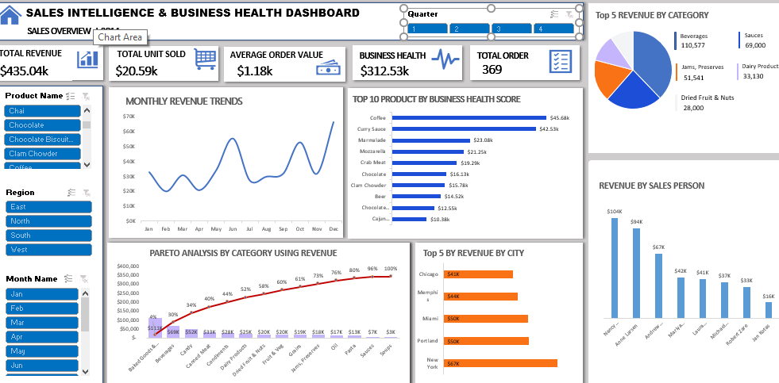

# altschool-sales-business-health-dashboard
Sales Intelligence and Business Health Dashboard built in Microsoft Excel as part of the AltSchool Africa Data Analysis programme.
## Project Overview

This project involved building a Sales Intelligence and Business Health Dashboard using Microsoft Excel as part of the AltSchool Africa Data Analysis programme. I used PivotTables, key performance indicators (KPIs), and data visualizations to analyze business performance.

The dashboard examines total revenue, units sold, order volume, average order value, monthly revenue trends, revenue by product and category, sales performance by salesperson, and the top five cities by revenue. I also analyzed cumulative revenue by category to understand how different categories contribute to overall sales and evaluated business health scores across products.

The project demonstrates my ability to organize and summarize sales data, identify performance patterns, and present business insights to support data-driven decision-making.
## Dashboard Preview

